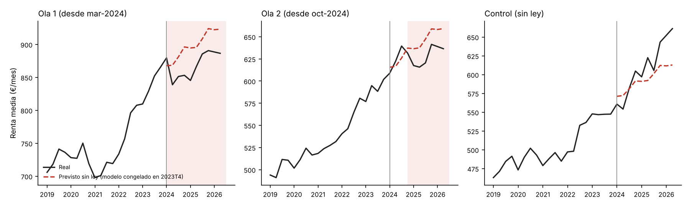
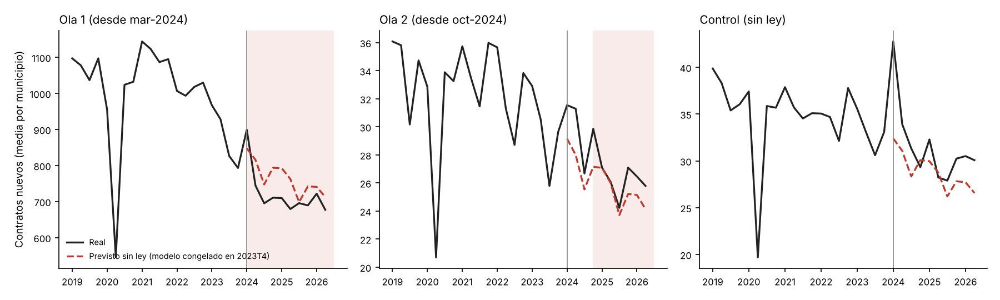

# Entrega 03 · Machine Learning

**Punto de partida:** el Gold de la Entrega 02 (`data/gold/panel_municipio_trimestre.parquet`), un panel de 942 municipios catalanes × 30 trimestres (2019T1–2026T2) con la renta media y los contratos nuevos de alquiler del registro de fianzas del Incasòl. Se usa la **muestra principal** definida en la Entrega 02: 250 municipios (134 de la ola 1, 87 de la ola 2 y 29 de control), que suman el 95,6 % de los contratos.

**Código:**
- `src/modelado.py`: baseline y selección del modelo (apartado 3).
- `src/evaluacion.py`: previsión congelada, comparación con la realidad y salida para el producto (apartados 4 y 5).

**Resultados:** carpeta `results/`. Cada cifra de este documento sale de uno de sus ficheros.

---

## 1. Qué problema resuelve el modelo

**Pregunta del proyecto (Entrega 02):** ¿qué efecto tuvo la declaración de zonas tensionadas (Ley 12/2023) sobre la renta del alquiler y el número de contratos nuevos registrados en Cataluña?

Para responderla hay que saber **qué habría pasado sin la ley**, y eso no se puede observar. El ML aporta justamente eso: una **previsión, hecha antes de la norma, de cómo habrían evolucionado la renta y los contratos de cada municipio**. Cuando ya se conocen los datos reales, la diferencia entre lo que pasó y lo que se esperaba indica si la norma tuvo efecto.

La regla de oro del enfoque es que **el modelo se entrena solo con datos hasta 2023T4**, el último trimestre completo antes de la ola 1 (16/03/2024). No ve nada posterior a la norma, ni siquiera de los municipios que no la aplicaron. Primero se predice y después se compara.

**Funcionalidad del producto:** un panel o mapa municipal que muestra, para cada municipio tensionado, la renta y los contratos reales junto a la previsión "sin ley", con su rango y el efecto estimado.

**Quién lo usa y para qué:**

| Usuario | Decisión o acción que permite |
|---|---|
| Administraciones (Generalitat, ayuntamientos) | Evaluar si la declaración funciona y decidir si prorrogarla, ampliarla a otros municipios o retirarla. |
| Periodistas, analistas y entidades | Contrastar con datos el debate sobre el tope al alquiler, municipio a municipio. |
| Inquilinos y propietarios | Saber cuánto se ha desviado el alquiler de su municipio de la tendencia que llevaba. |

**Tipo de problema:** **predicción** (regresión de series temporales en panel). Se predice el valor futuro de la renta y de los contratos de cada municipio. La predicción se usa después para una **estimación causal**: efecto = real − previsto, contrastado con municipios sin ley.

---

## 2. Datos de entrada y salida

**Salidas (variables objetivo):**
- `log_renta`: logaritmo de la renta media de los contratos nuevos (€/mes).
- `log_contratos`: logaritmo de (1 + contratos nuevos del trimestre).

Se trabaja en logaritmos para que las diferencias se lean como porcentajes y Barcelona (7.800 contratos al trimestre) no aplaste a un municipio de 30. Concretamente, el modelo predice **el cambio** de cada variable respecto al nivel medio del municipio en el último año, *h* trimestres después (con *h* de 1 a 10).

**Entradas (todo calculado en el trimestre de origen, sin mirar después):**

| Variable | Qué recoge |
|---|---|
| `base_r`, `base_c` | Nivel medio de renta y de contratos del municipio en los últimos 4 trimestres. |
| `var_anual_r`, `var_anual_c` | Cambio del último año frente al anterior. |
| `pendiente_r`, `pendiente_c` | Tendencia de los últimos 8 trimestres. |
| `volatilidad_r`, `volatilidad_c` | Cuánto oscila la serie del municipio. |
| `mercado_var_anual_r`, `mercado_var_anual_c` | Momento del mercado catalán: mediana del cambio anual de todos los municipios en ese origen. |
| `provincia` | Barcelona, Girona, Lleida o Tarragona. |
| `h`, `trimestre_objetivo` | Horizonte de la previsión y estacionalidad. |
| `ley_2020_en_objetivo` | Si el trimestre previsto cae en el tope autonómico de 2020–2022 (marcado en la Entrega 02). |

Todas están disponibles en el momento de uso: para prever 2024–2026 basta con la historia hasta 2023T4.

**Riesgos de fuga de información y cómo se controlan:**

1. **Ver el efecto de la ley durante el entrenamiento.** Ninguna fila de entrenamiento tiene un objetivo posterior a 2023T4. En la previsión final tampoco entra ningún dato de 2024 o posterior, ni de tratados ni de control.
2. **Usar el futuro en las variables.** Las variables de cada origen solo usan los 8 trimestres anteriores.
3. **Validar con datos que el modelo ya vio.** En los backtests, el modelo de cada corte se entrena solo con objetivos anteriores al corte.
4. **Elegir el modelo mirando el efecto.** El modelo se elige solo por su error de previsión antes de la ley (apartado 3), con una regla fijada antes de calcular ningún efecto.

**Sesgos y calidad:**
- **Los municipios tensionados no son aleatorios.** Se declararon porque sus alquileres subían rápido. Los backtests lo confirman: antes de 2024, la ola 1 ya subía más que el control (apartado 4).
- **Grupo de control pequeño y distinto:** 29 municipios que suman el 2,4 % de los contratos. Por eso el contraste con ellos se acompaña de otras medidas.
- **2026T1:** la fuente no publica la renta de casi ningún municipio (Entrega 02). Se trata como dato ausente.
- **Fianzas del Incasòl:** solo contratos nuevos de vivienda habitual. Si el alquiler se desvía a temporada o a uso turístico, eso no se ve.
- **Ruido de los municipios pequeños:** su renta oscila mucho de un trimestre a otro. Por eso los resultados de grupo se ponderan por los contratos de 2023.

---

## 3. Baseline y selección de modelos

### 3.1 Modelos comparados

| | Qué hace | Por qué |
|---|---|---|
| **B0 · Persistencia** | Supone que todo sigue en el nivel medio del último año. | La referencia más simple. |
| **B1 · Tendencia propia** | Prolonga en línea recta la tendencia de los últimos 2 años de cada municipio. | Es lo que haría un analista con una hoja de cálculo. **Es el baseline de referencia.** |
| **M1 · Ridge** | Regresión lineal regularizada con todas las variables del apartado 2 y su interacción con el horizonte. | Combina la tendencia propia con el momento del mercado y la estacionalidad, sin sobreajustar. Es interpretable. |
| **M2 · LightGBM** | Árboles de *gradient boosting* con las mismas variables. | Puede captar relaciones no lineales, por ejemplo que los municipios que más han subido frenen más. |

Los modelos M1 y M2 se entrenan con **todos los orígenes posibles**: cada trimestre desde 2020T4, cada municipio y cada horizonte de 1 a 10 trimestres. Para la previsión final son 18.672 filas en renta y 18.740 en contratos.

### 3.2 Cómo se comparan: backtests sin ver el futuro

Se simulan cuatro momentos anteriores a la ley: **2021T2, 2021T4, 2022T2 y 2022T4**. En cada uno, el modelo se entrena solo con datos hasta ese trimestre y predice los siguientes hasta 2023T4, cuando todavía no había ley.

**Métrica principal:** el **error del grupo agregado**, la media ponderada por contratos de (real − previsto) en cada grupo (ola 1, ola 2 y control), en valor absoluto. Es la métrica que importa, porque el efecto de la ley se mide sobre el grupo. Como métrica secundaria se da el error mediano de un municipio individual.

**Pesos sin mirar el futuro:** en cada corte, el peso de un municipio son sus contratos medios en los 4 trimestres que terminan en ese corte. Por ejemplo, el corte 2021T4 usa 2021T1–2021T4. Así los backtests no usan información de 2023. Una versión anterior ponderaba todos los cortes con los contratos de 2023; al corregirlo, los errores suben algo (sobre todo en contratos), pero el modelo elegido no cambia (`results/03_backtest_resumen.csv`).

### 3.3 Resultados

`results/03_backtest_resumen.csv` (media de los 4 cortes y de todos los horizontes)

| Modelo | Renta: error grupo | Renta: error municipio | Contratos: error grupo | Contratos: error municipio |
|---|---:|---:|---:|---:|
| B0 · Persistencia | 9,5 % | 9,5 % | 11,1 % | 16,5 % |
| B1 · Tendencia propia | 8,3 % | 9,6 % | 18,8 % | 25,5 % |
| **M1 · Ridge** | **7,0 %** | **7,5 %** | **9,7 %** | **15,7 %** |
| M2 · LightGBM | 7,5 % | 8,2 % | 14,5 % | 18,4 % |

### 3.4 Modelo elegido

**Ridge (M1) para las dos variables.** La regla, fijada antes de ejecutar los backtests, era elegir el menor error de grupo y, si otro más sencillo quedaba a menos de 0,25 puntos, quedarse con el más sencillo.

- Frente al baseline B1, Ridge reduce el error de grupo del 8,3 % al 7,0 % en renta y del 18,8 % al 9,7 % en contratos. La tendencia en línea recta funciona mal con los contratos porque la serie tiene mucha estacionalidad y caídas puntuales, como la del confinamiento de 2020.
- LightGBM no mejora a Ridge. Hay pocos datos (250 municipios y unos 12 orígenes) y los árboles no extrapolan tendencias. No se valora la complejidad por sí misma.

Aun así, el error de grupo del 7–10 % es grande. La subida de 2022–2023 fue más fuerte de lo que ninguna tendencia anterior anticipaba. Por eso el efecto no se lee solo como "real − previsto": se contrasta con municipios sin ley y con placebos (apartado 4).

---

## 4. Validación y evaluación

### 4.1 Estrategia de separación

| Datos | Uso |
|---|---|
| Hasta **2023T4** | Entrenar y elegir el modelo (backtests con cortes en 2021T2–2022T4). |
| **2024T1–2026T2** | **Nunca vistos por el modelo.** Se comparan con la previsión congelada en 2023T4. |

La separación es **temporal**: no hay validación aleatoria, que mezclaría trimestres posteriores con anteriores. Los trimestres de entrada en vigor (2024T1 para la ola 1 y 2024T4 para la ola 2) se muestran, pero no cuentan para el efecto, porque solo están tratados en parte.

### 4.2 Cómo se mide el efecto y cuánto fiarse

- **Efecto sin ajustar:** real − previsto en los municipios tensionados. Supone que el modelo habría acertado sin ley.
- **Efecto ajustado por control:** (real − previsto en tensionados) − (real − previsto en los 29 de control). Descuenta los cambios del mercado que el modelo no podía prever, pero depende de esos 29 municipios.
- **Ola 1 frente a ola 2:** el mismo ajuste en 2024T2–2024T3, usando como control los 87 municipios de la ola 2, que aún no tenían la ley.
- **IC 95 % por *bootstrap*:** el cálculo se repite 2.000 veces remuestreando municipios dentro de cada grupo.
- **Placebos:** el mismo cálculo en los 4 backtests anteriores a la ley, con una ventana de 6 trimestres. Ahí el efecto real es 0, así que lo que salga es "efecto falso". Un efecto solo es creíble si se separa claramente de los placebos.
- El IC del *bootstrap* solo recoge la incertidumbre por la muestra de municipios, no el error del propio modelo. Ese error lo miden los placebos, y por eso se presentan los dos.
- **Contraste clásico:** diferencias en diferencias con efectos fijos de municipio y trimestre y errores agrupados por municipio.

### 4.3 Resultados fuera de entrenamiento



**Renta** (`results/04_resultados.json`, `results/04_placebos_log_renta.csv`)

| | Efecto | IC 95 % | Efecto falso en placebos |
|---|---:|---:|---:|
| Ola 1 · sin ajustar | **−3,8 %** | −4,8 / −2,1 | +8,2 a +12,5 % |
| Ola 1 · ajustado por control | **−5,9 %** | −8,2 / −3,4 | +5,4 a +7,2 % |
| Ola 1 · frente a ola 2 (2024T2–T3) | **−4,8 %** | −6,3 / −3,4 | +3,6 a +6,3 % |
| Ola 2 · sin ajustar | **−3,4 %** | −4,5 / −2,3 | +2,4 a +5,8 % |
| Ola 2 · ajustado por control | **−6,9 %** | −9,3 / −4,7 | +0,1 a +1,8 % |
| *Contraste: DiD clásico (tensionados)* | −4,9 % | −6,1 / −3,7 | — |

**Lectura:**
- Antes de la ley, el modelo **se quedaba corto** con los tensionados: su renta subía más de lo previsto (placebos positivos). Desde la ley **se pasa**: la renta real queda entre un 3 % y un 7 % por debajo de lo esperado. El signo se invierte justo cuando entra la norma, así que el efecto estimado es, si acaso, **conservador**.
- La ola 2 da un resultado muy limpio: placebos de casi 0 y un efecto ajustado del −6,9 %.
- Las cinco medidas y el DiD clásico dan entre −3,4 % y −6,9 %. Con los cuatro modelos (tabla 4.4), el efecto ajustado va de −5,9 % a −7,2 %, salvo la tendencia en línea recta, que da −12,3 %.
- El efecto **sin ajustar** sí depende del modelo: con la persistencia (B0) sale positivo (+3,1 % en la ola 1). Por eso la cifra principal es la ajustada por control.
- En los municipios de control, sin ley, la renta acabó **por encima** de lo previsto en 7 de los 8 trimestres (entre −3 % y +8 %). En la ola 1 quedó por debajo en todos los trimestres desde la ley (entre −2,5 % y −5,5 %).



**Contratos** (`results/04_placebos_log_contratos.csv`)

| | Efecto | IC 95 % | Efecto falso en placebos |
|---|---:|---:|---:|
| Ola 1 · sin ajustar | −7,0 % | −8,3 / −4,9 | −3,8 a −17,7 % |
| Ola 1 · ajustado por control | −12,7 % | −18,1 / −5,4 | −2,9 a −9,2 % |
| Ola 1 · frente a ola 2 (2024T2–T3) | −14,5 % | −18,4 / −9,0 | −1,5 a −5,6 % |
| Ola 2 · sin ajustar | +3,5 % | −1,7 / +8,8 | −13,3 a +2,0 % |
| Ola 2 · ajustado por control | −3,3 % | −11,1 / +5,9 | −5,3 a +2,9 % |
| *Contraste: DiD clásico (tensionados)* | −17,8 % | −23,2 / −12,0 | — |

**Lectura:** los contratos cayeron en la ola 1 más de lo previsto. El problema es que en los placebos ya salían "efectos" de −4 % a −18 % sin ajustar y de −3 % a −9 % ajustados: esos municipios ya perdían contratos más rápido antes de la ley. Además:
- La comparación ola 1 frente a ola 2 se separa algo más de sus placebos (−14,5 % frente a −2 % a −6 %), pero solo cubre 2 trimestres.
- La ola 2 no muestra efecto claro: sus intervalos incluyen el 0.
- El resultado cambia mucho según el modelo: de +1,9 % con la tendencia en línea recta a −13 % con la persistencia o LightGBM.
- El DiD clásico (−17,8 %) no tiene en cuenta esa tendencia previa y probablemente exagera.

**Conclusión: hay indicios de menos contratos, pero con estos datos no se pueden separar de la tendencia que ya existía.**

### 4.4 Comparación con el baseline (robustez)

El mismo efecto ajustado por control, calculado con cada modelo (`results/04_resultados.json`):

| Modelo | Renta ola 1 | Renta ola 2 | Contratos ola 1 | Contratos ola 2 |
|---|---:|---:|---:|---:|
| B0 · Persistencia | −7,2 % | −7,1 % | −13,3 % | −2,7 % |
| B1 · Tendencia propia | −12,3 % | −7,7 % | +1,9 % | +7,5 % |
| **M1 · Ridge (elegido)** | **−5,9 %** | **−6,9 %** | **−12,7 %** | **−3,3 %** |
| M2 · LightGBM | −6,6 % | −6,8 % | −13,1 % | −1,8 % |

En renta, todos los modelos dan un efecto negativo. Los tres con menor error de previsión coinciden entre −5,9 % y −7,2 %, así que la conclusión no depende del modelo. En contratos, el baseline de tendencia da incluso el signo contrario: otra señal de que ahí el resultado no es robusto.

### 4.5 Análisis de errores

**1. Error de previsión alto en términos absolutos.** Incluso el mejor modelo falla un 7,0 % en el agregado de grupo y un 7,5 % en un municipio típico (renta). En contratos, un 9,7 % y un 15,7 %. La subida de 2022–2023 no estaba en ninguna tendencia previa. Por eso no se usa nunca el "sin ajustar" solo.

**2. El rango por municipio está sesgado hacia arriba.** El rango del 80 % de cada municipio se calibra con los errores de los backtests. Como en 2022–2023 la renta subió más de lo previsto, el rango queda asimétrico: a 10 trimestres va de −1 % a +24 % sobre la previsión. Con ese rango:
- En los municipios de control, el 31 % acaba fuera en el último trimestre (cobertura del 69 %, por debajo del 80 % nominal), repartidos por arriba (17 %) y por abajo (14 %).
- En la ola 1, el **75 %** acaba fuera, y casi todos por debajo (74 %). En la ola 2, el 66 %, también por debajo (62 %).

**3. El efecto en renta es homogéneo** (`results/04_efecto_por_tamano.csv`, `results/04_efecto_por_provincia.csv`). La mediana por municipio va del −5 % al −8 % según el tamaño (pequeño, mediano o grande) y la provincia. El 86 % de los 221 municipios tensionados tiene una diferencia ajustada negativa.

**4. Grandes municipios** (`results/05_efecto_por_municipio.csv`, diferencia media ajustada en renta):

| Municipio | Previsto sin ley 2026T2 | Real 2026T2 | Diferencia ajustada (media desde la ley) |
|---|---:|---:|---:|
| Barcelona | 1.230 € | 1.141 € | −7,8 % |
| L'Hospitalet de Llobregat | 876 € | 836 € | −4,7 % |
| Terrassa | 775 € | 768 € | −3,6 % |
| Sabadell | 838 € | 841 € | −2,4 % |
| Badalona | 948 € | 1.079 € | +0,9 % |
| Tarragona | 741 € | 700 € | −8,3 % |

Badalona es la excepción: su renta real supera la prevista. Un solo municipio puede desviarse por causas locales, así que la cifra fiable es la de grupo.

**5. Los municipios de control son ruidosos.** En contratos, la diferencia real − previsto entre los 29 municipios va del −27 % al +88 %. Con tan pocos contratos, el ajuste por control añade mucha incertidumbre. Se ve en el intervalo de contratos (−18 % a −5 %).

### 4.6 Limitaciones principales

1. **Los tensionados no son comparables a los de control:** se eligieron porque su alquiler subía rápido. Los placebos lo muestran y lo cuantifican.
2. **El control son 29 municipios pequeños** (2,4 % de los contratos). Se compensa con la comparación ola 1 frente a ola 2, pero esta solo cubre 2 trimestres.
3. **Pocos trimestres después de la ley:** 8–9 para la ola 1 y 5–6 para la ola 2 (2026T1 no tiene renta). No se pueden medir efectos a largo plazo.
4. **Error de previsión alto** frente a los efectos que se buscan, sobre todo en contratos.
5. **No se ve el desvío a alquiler de temporada o turístico**, que no pasa por el Incasòl. Una caída de contratos podría ser desvío y no pérdida de vivienda.
6. **Asociación con fuerte apoyo, no prueba definitiva:** el diseño no descarta otros cambios que coincidieran en el tiempo solo en los municipios tensionados.

---

## 5. Decisión y uso en el producto

### 5.1 Solución elegida

**Regresión Ridge entrenada solo con datos hasta 2023T4**, que prevé la renta y los contratos de cada municipio "sin ley". El efecto se calcula como real − previsto, ajustado por los municipios sin ley y contrastado con placebos.

**Por qué:**
- Es el modelo que mejor prevé antes de la ley: 7,0 % de error de grupo en renta, frente al 8,3 % del baseline de tendencia.
- Es lineal e interpretable.
- Su estimación coincide con el DiD clásico y con los demás modelos.

**Qué mejora ofrece:** frente al DiD clásico, que da una sola cifra para toda Cataluña, el modelo da **una previsión y un efecto para cada municipio y trimestre**, que es lo que necesita un mapa o un panel. Además permite **comprobar con placebos** cuánto efecto sale por puro ruido.

**¿Es suficiente para el MVP?**
- **Renta: sí.** El resultado ajustado (−5 % a −7 % frente a lo esperado) es estable entre métodos y modelos y se separa claramente de los placebos.
- **Contratos: solo como indicador descriptivo.** El producto debe mostrar la caída, pero indicando que no se puede atribuir con seguridad a la ley.

### 5.2 Salida que consume el frontal

Una fila por municipio y variable (`results/05_efecto_por_municipio.csv`), más el resumen por ola (`results/04_resultados.json`). Ejemplo para Barcelona (`results/05_ejemplo_salida.json`):

```json
{
  "municipio": "Barcelona",
  "codigo_ine": "08019",
  "grupo": "ola 1 (zona tensionada desde 16/03/2024)",
  "ultimo_trimestre": "2026Q2",
  "renta": {
    "real_eur_mes": 1140.9,
    "prevista_sin_ley_eur_mes": 1229.8,
    "rango_prevision_eur_mes": [1219.3, 1530.9],
    "diferencia_media_desde_la_ley_pct": -5.76,
    "diferencia_ajustada_por_control_pct": -7.78
  },
  "contratos": {
    "real_trimestre": 7845.0,
    "previstos_sin_ley": 8050.2,
    "rango_prevision": [5473.2, 11580.6],
    "diferencia_media_desde_la_ley_pct": -8.44,
    "diferencia_ajustada_por_control_pct": -14.02
  },
  "efecto_conjunto_ola": {
    "log_renta": { "estimacion": -5.87, "ic95_bootstrap": [-8.18, -3.4] },
    "log_contratos": { "estimacion": -12.67, "ic95_bootstrap": [-18.14, -5.42] }
  },
  "avisos": ["…"]
}
```

| Campo | Significado | Cautela para mostrarlo |
|---|---|---|
| `real_*` | Dato real del último trimestre disponible (Incasòl). | Contratos nuevos, no el parque completo. |
| `prevista_sin_ley_*` | Lo que el modelo, congelado en 2023T4, esperaba para ese trimestre. | Es una estimación, no un dato. |
| `rango_prevision_*` | Dónde habría caído el dato sin ley en 8 de cada 10 casos, según los errores históricos del modelo. | Es asimétrico porque el modelo tendía a quedarse corto. En municipios sin ley se cumple en un 69 % de los casos. |
| `diferencia_media_desde_la_ley_pct` | Media de (real − previsto) en todos los trimestres desde la ley. | Incluye cambios de mercado que el modelo no podía prever. |
| `diferencia_ajustada_por_control_pct` | Lo mismo, descontando lo que se desviaron los municipios sin ley. | **Cifra principal**, pero apoyada en solo 29 municipios de control. Es una estimación: si el municipio ya seguía una tendencia distinta antes de 2024, parte de la diferencia puede venir de ahí. |
| `efecto_conjunto_ola` | Efecto del grupo, con intervalo del 95 %. | Es la cifra fiable. La de un municipio concreto es orientativa. |
| `avisos` | Textos que deben verse siempre. | Visibles, no en letra pequeña. |

**Cómo se mostraría:** un mapa de Cataluña coloreado por `diferencia_ajustada_por_control_pct` y, al pulsar un municipio, su gráfico real frente a previsto (como los de este documento). En contratos, una etiqueta "indicador no concluyente".

**Aviso fijo junto al mapa:** *"El color muestra cuánto se ha desviado cada municipio de lo que se esperaba sin la ley. Es una estimación, no una medida directa del efecto de la ley: los municipios tensionados ya seguían tendencias distintas antes de 2024, y parte de la diferencia puede venir de ahí."* Los placebos del apartado 4 muestran que ese sesgo existe: en renta va en sentido contrario al efecto estimado, y en contratos en el mismo sentido. Por eso la renta se presenta como resultado y los contratos solo como indicio.

---

## Reproducibilidad

```bash
pip install pandas pyarrow numpy scikit-learn lightgbm statsmodels matplotlib
python src/preparacion_datos.py    # Entrega 02: descarga el CSV del Incasòl y genera el Gold
python src/modelado.py             # Apartado 3: backtests y elección del modelo (~10 s)
python src/evaluacion.py           # Apartados 4 y 5: previsión congelada, efectos y salida (~2 min)
```

Semilla fija (`42`). Versiones probadas: Python 3.13, pandas 3.0.5, scikit-learn 1.9.1, LightGBM 4.7.0 y statsmodels 0.15.0. Se ha usado la instantánea del Incasòl de la Entrega 02 (SHA-256 `602427…7a7`). Con una descarga más reciente las cifras pueden variar ligeramente.
