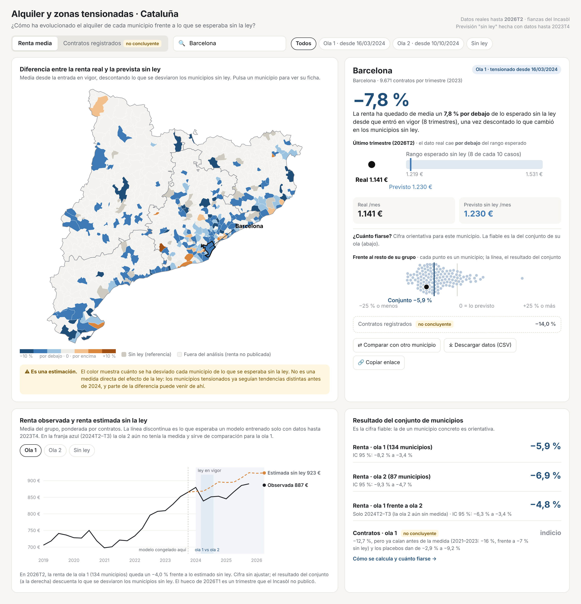
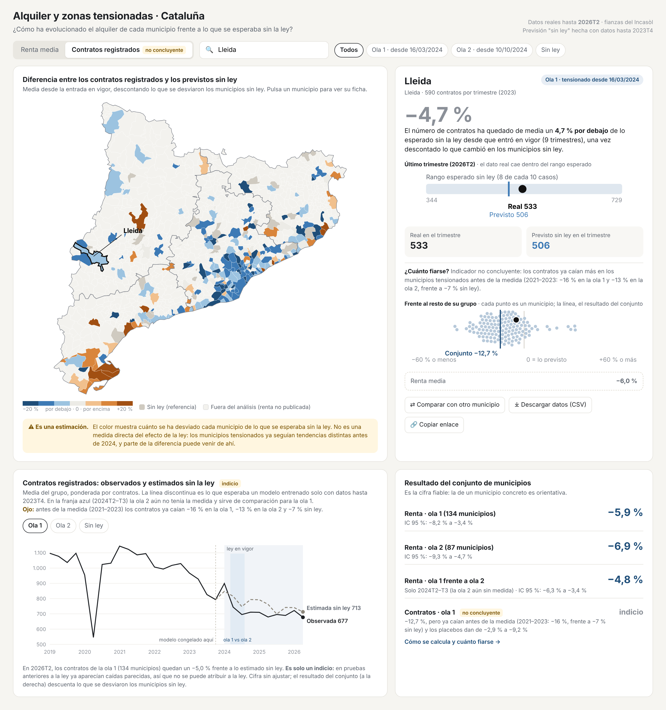

# Entrega 04 · Diseño del frontal y experiencia de usuario

**Punto de partida:** los resultados de la Entrega 03 (carpeta `results/`). El frontal no calcula nada nuevo: muestra la previsión "sin ley" del modelo Ridge congelado en 2023T4, la diferencia con los datos reales del Incasòl y el efecto del conjunto de municipios, con sus intervalos y avisos.

**Mockup:** `docs/entregas/mockup/04_mockup.html`. Es un prototipo HTML que funciona con los datos reales de la Entrega 03, no con datos de ejemplo. Las imágenes de este documento son capturas de ese prototipo.

---

## 1. Utilidad y valor del producto

**Problema.** Desde 2024 hay 221 municipios catalanes declarados zona de mercado residencial tensionado (Ley 12/2023): 134 en la ola 1 (desde el 16/03/2024) y 87 en la ola 2 (desde el 10/10/2024). El debate sobre si la medida funciona se hace casi siempre con cifras sueltas, como "el alquiler ha bajado" o "ha subido", que no responden a la pregunta de fondo: **¿qué habría pasado sin la ley?** El producto da esa respuesta para cada municipio, con su grado de fiabilidad.

**A quién se dirige:**

| Usuario | Qué podrá decidir o hacer |
|---|---|
| **Usuario principal:** técnicos de administraciones (Generalitat, ayuntamientos) | Ver si su municipio se ha desviado de lo esperado y apoyar con datos la decisión de prorrogar, ampliar o retirar la declaración. |
| Periodistas, analistas y entidades | Contrastar el debate municipio a municipio, con la cifra fiable (la del grupo) separada de la orientativa (la del municipio). |
| Inquilinos y propietarios | Saber cuánto se ha desviado el alquiler de su municipio de la tendencia que llevaba. |

El diseño se orienta al usuario principal, que no es estadístico pero sí está acostumbrado a leer indicadores. Si a él le resulta claro, a los demás también.

**Funcionalidades esenciales del MVP:**

1. **Mapa de Cataluña** con cada municipio coloreado según cuánto se ha desviado del valor previsto sin ley (`diferencia_ajustada_por_control_pct`).
2. **Ficha del municipio:** valor real, previsto sin ley, rango esperado y diferencia media desde la ley, con una indicación de cuánto fiarse de la cifra.
3. **Resultado del conjunto:** el efecto por ola con su intervalo del 95 %, que es la cifra fiable, y su evolución trimestre a trimestre frente a los municipios sin ley.
4. **Selector de variable:** renta media (resultado principal) o contratos registrados, marcado como **indicador no concluyente**, tal y como concluye la Entrega 03.

**Qué no hace el producto:** no predice el alquiler futuro ni recomienda precios. Compara lo ocurrido con lo esperado y lo deja claro en la propia pantalla.

---

## 2. Flujo de usuario

El recorrido cabe en una sola pantalla, sin registro y sin pasos intermedios:

```
Entra ──► Ve el mapa (renta, todos los municipios) y el resultado del conjunto
   │
   ├─► Busca su municipio o lo pulsa en el mapa ──► Ficha: real vs previsto, rango y fiabilidad
   │                                                   │
   │                                                   └─► Compara con su grupo (franja de puntos)
   │
   ├─► Cambia a "Contratos registrados" ──► Mismo mapa y ficha, con aviso de "no concluyente"
   ├─► Filtra por grupo (ola 1 / ola 2 / sin ley) ──► El mapa atenúa el resto
   │
   └─► Después: descarga los datos (CSV), copia el enlace o compara con otro municipio
```

| Paso | Qué introduce o selecciona | Qué recibe |
|---|---|---|
| 1. Entrada | Nada. | El mapa de la renta y, abajo, el resultado del conjunto (−5,9 % en la ola 1 y −6,9 % en la ola 2). Así, el primer dato que ve ya es el fiable. |
| 2. Elegir municipio | Escribe el nombre (con autocompletado) o lo pulsa en el mapa. | La ficha: diferencia media desde la ley, último trimestre real frente al previsto con su rango y cuánto fiarse de la cifra. |
| 3. Situarlo | Nada: la ficha ya lo muestra. | Su posición entre los municipios de su ola y la línea del resultado del conjunto. |
| 4. Cambiar de variable o de grupo | Pulsa "Contratos registrados" o un filtro de ola. | El mismo mapa y la misma ficha con la otra variable, o el mapa centrado en un grupo. |
| 5. Después | Descargar, copiar enlace o comparar. | El CSV del municipio (las mismas columnas de `results/05_efecto_por_municipio.csv`) o un enlace que abre la ficha directamente. |

Al entrar, la pantalla ya muestra un municipio (Barcelona, el de más contratos), para que nadie la vea vacía.

---

## 3. Diseño del frontal

### 3.1 Pantalla principal



| Zona | Qué muestra | Dato de origen (Entrega 03) |
|---|---|---|
| Cabecera | Pregunta del producto y frescura de los datos: reales hasta 2026T2, previsión con datos hasta 2023T4. | — |
| Controles | Variable (renta o contratos), buscador de municipio y filtro de grupo. | — |
| **Mapa** | 250 municipios del análisis coloreados por la diferencia ajustada. Los de control salen en gris y los que quedan fuera del análisis (renta no publicada), en blanco roto. El municipio elegido se resalta. Debajo, el aviso fijo. | `results/05_efecto_por_municipio.csv` · `diferencia_ajustada_media_pct` |
| **Ficha** | Barcelona: **−7,8 %** de diferencia media desde la ley. En 2026T2, real 1.141 €/mes frente a 1.230 € previstos y un rango de 1.219–1.531 €, así que el dato real cae por debajo del rango. Incluye su posición entre los 134 municipios de la ola 1 y la cifra de contratos con la etiqueta "no concluyente". | `results/05_efecto_por_municipio.csv` · `results/05_ejemplo_salida.json` |
| **Renta observada y estimada sin la ley** | Dos líneas por grupo (ola 1, ola 2 o sin ley, a elegir): la renta real desde 2019 y la que esperaba el modelo congelado en 2023T4. En la ola 1, en 2026T2: 887 €/mes observados frente a 923 € estimados sin ley (−4,0 % sin ajustar). Una franja azul marca 2024T2–2024T3, los dos únicos trimestres en que la ola 2 sirve de comparación para la ola 1 porque aún no tenía la medida (Entrega 02). En renta, 2026T1 queda como hueco "sin dato". | `results/04_serie_grupo_log_renta.csv` |
| **Resultado del conjunto** | Renta: ola 1 −5,9 % (IC 95 % −8,2 a −3,4) y ola 2 −6,9 % (−9,3 a −4,7). Como contraste, ola 1 frente a ola 2: −4,8 % (−6,3 a −3,4), con la indicación de que solo cubre 2024T2–T3. Contratos de la ola 1: −12,7 %, presentado como "indicio" porque ya caían antes de la medida (2021–2023: −16 % frente a −7 % sin ley) y los placebos daban de −2,9 % a −9,2 %. | `results/04_resultados.json` · tendencia previa: Entrega 02 |

### 3.2 Vista de contratos registrados



Es la misma pantalla con la otra variable. Cambian tres cosas: la escala de colores se amplía a ±20 % porque los contratos oscilan más, la cifra grande de la ficha sale **en gris** y no en color de resultado, y el apartado "¿Cuánto fiarse?" da la tendencia previa que describe la Entrega 02: entre 2021 y 2023 los contratos ya caían un 16 % en la ola 1 y un 13 % en la ola 2, frente a un 7 % en los municipios sin ley. Ese mismo dato aparece como aviso ("Ojo: …") encima del gráfico de renta observada y estimada, que en esta vista lleva la etiqueta "indicio".

### 3.3 Cómo abrir el prototipo

```bash
python src/frontal_mockup.py                 # regenera docs/entregas/mockup/datos_mockup.js desde results/
# abrir docs/entregas/mockup/04_mockup.html en el navegador
```

El prototipo es interactivo: se pueden pulsar municipios, buscar, cambiar de variable y filtrar. Los botones de la ficha (comparar, descargar y copiar enlace) solo están dibujados. Se adapta a pantallas de móvil, donde las zonas se apilan en una columna.

---

## 4. Experiencia de usuario

El principio del diseño es que **el usuario no necesita entender el modelo, pero sí cuánto puede fiarse de cada cifra**. La Entrega 03 concluye que la renta es un resultado sólido y los contratos solo un indicio, y que la cifra fiable es la del grupo, no la de un municipio. El frontal se construye para que esas tres ideas se vean sin tener que leer el documento técnico.

### 4.1 Claridad de la información

- **Una sola pregunta y una sola medida protagonista.** Todo gira en torno a "¿cuánto se ha desviado de lo esperado sin la ley?". La cifra principal es siempre la **diferencia ajustada por los municipios sin ley**, la que la Entrega 03 elige como principal. La diferencia sin ajustar no se muestra en pantalla, porque depende del modelo (con la persistencia, la de la ola 1 sale incluso positiva) y llevaría a conclusiones distintas según cómo se mire.
- **La frase explica la cifra.** Debajo del −7,8 % hay una frase completa: *"La renta ha quedado de media un 7,8 % por debajo de lo esperado sin la ley desde que entró en vigor (8 trimestres), una vez descontado lo que cambió en los municipios sin ley"*. Así no hace falta saber qué es un "efecto ajustado por control".
- **Cada comparación, con su alcance.** La comparación de la ola 1 con la ola 2 se muestra, pero siempre con el aviso "solo 2024T2–T3", porque son los dos únicos trimestres en que la ola 2 todavía no tenía la medida (Entrega 02). Así nadie la lee como una cifra de todo el periodo.
- **Lenguaje llano.** Se habla de "previsto sin ley", "rango esperado (8 de cada 10 casos)" y "municipios sin ley", no de "contrafactual", "intervalo de predicción" o "grupo de control". Los términos técnicos quedan para la página "Cómo se calcula".
- **Cifra fiable y cifra orientativa, separadas.** El resultado del conjunto tiene su propio bloque con la indicación *"Es la cifra fiable: la de un municipio concreto es orientativa"*. Responde al punto 4 del análisis de errores de la Entrega 03 (Badalona se desvía en sentido contrario al de su grupo).
- **Aviso fijo junto al mapa**, con el texto acordado en la Entrega 03: es una estimación, no una medida directa del efecto, y los municipios tensionados ya seguían tendencias distintas antes de 2024. Va en un recuadro de color justo debajo del mapa, no en letra pequeña ni detrás de un icono.
- **Frescura visible.** La cabecera indica que los datos reales llegan hasta 2026T2 y que la previsión se hizo con datos hasta 2023T4. Esa segunda fecha es la clave del método: el modelo no vio nada posterior a la ley.

### 4.2 Gráficos y controles elegidos

| Elemento | Por qué este y no otro |
|---|---|
| **Mapa coroplético municipal** | Los usuarios piensan por municipio y por territorio, y el dato del producto es municipal. El mapa permite ver de un vistazo si el patrón es general (lo es: el 86 % de los tensionados tiene una diferencia negativa en renta) o se concentra en una zona. |
| **Escala divergente azul / naranja con centro neutro** | La pregunta tiene un cero natural (lo previsto). El azul indica "por debajo de lo esperado" y el naranja "por encima". Se evita el rojo y verde porque sugiere "bueno o malo", y si una bajada del alquiler es buena o mala depende de quién mire. Además, la escala se lee bien con daltonismo. |
| **Escala en 7 tramos, no continua** | Con tramos (±1, ±5 y ±10 % en renta) dos municipios con el mismo color están realmente en el mismo rango. Una escala continua invita a comparar décimas que el modelo no puede distinguir. |
| **Gris para los municipios sin ley** | Su papel es servir de referencia, no ser evaluados. Colorearlos haría pensar que también tienen un "efecto". |
| **Barra de rango (real · previsto · rango esperado)** | Es la forma más directa de enseñar la incertidumbre del modelo: la barra es lo que cabría esperar sin ley, la marca azul la previsión y el punto negro el dato real. Se ve enseguida si el dato real cae dentro o fuera. El rango asimétrico de la Entrega 03 (la previsión está cerca del borde inferior) queda a la vista, sin ocultarlo. |
| **Franja de puntos con los municipios del grupo** | Sitúa al municipio entre los de su ola y marca la línea del resultado del conjunto. Muestra a la vez la dispersión entre municipios y por qué la cifra fiable es la del grupo. |
| **Renta observada frente a renta estimada sin la ley** | Es el gráfico central de la demo, porque enseña el método sin explicarlo: la línea continua es lo que pasó y la discontinua lo que el modelo esperaba con datos hasta 2023T4. En la ola 1 la renta observada queda por debajo de la estimada desde que entra la ley; en los municipios sin ley queda por encima (+7,9 % en 2026T2), que es el desvío del mercado que se descuenta en la cifra ajustada. La franja azul marca la ventana en que la ola 2 sirve de comparación. En contratos el mismo gráfico lleva la etiqueta **indicio** y el aviso de la tendencia previa, porque en las pruebas anteriores a la ley ya aparecían caídas parecidas. |
| **Selector de variable con etiqueta "no concluyente"** | Los contratos se muestran, porque el usuario los pedirá, pero la etiqueta acompaña a la variable en el selector, en la ficha y en el resumen. |
| **Buscador con autocompletado y clic en el mapa** | Hay dos formas de llegar al municipio: quien sabe cuál busca, lo escribe; quien explora, pulsa en el mapa. |
| **Filtro por grupo** | Atenúa los demás municipios en lugar de ocultarlos, para no perder el contexto. |

**Descartado a propósito:** gráficos de tarta, 3D, velocímetros, tablas con los 250 municipios en pantalla y cuadros de mando con muchos KPI. Tampoco se muestran los intervalos del bootstrap municipio a municipio, porque la Entrega 03 solo los calcula para el grupo. La tabla completa queda en la descarga CSV.

### 4.3 Facilidad de uso

- **Una pantalla y cero configuración.** Todo lo esencial se ve sin desplazarse en un monitor de escritorio. No hay registro ni parámetros del modelo que tocar.
- **Estado inicial útil.** Se abre con la renta, todos los municipios y la ficha de Barcelona. El primer vistazo ya da una respuesta.
- **Coherencia entre variables.** Renta y contratos usan la misma pantalla y los mismos componentes. Solo cambian la escala y las advertencias, así que no hay nada nuevo que aprender.
- **Tooltip al pasar por el mapa** con el nombre y la cifra, para explorar sin tener que pulsar.
- **Adaptable a móvil.** En pantallas estrechas las zonas se apilan en este orden: mapa, ficha, evolución y resumen.
- **Accesibilidad:** el significado nunca depende solo del color, porque todas las cifras llevan signo (+ / −) y texto ("por debajo" / "por encima"). El contraste es alto y la tipografía, legible (Inter, 14 px de base).

### 4.4 Gestión de errores y resultados inciertos

Los resultados de la Entrega 03 tienen incertidumbres concretas, y cada una tiene su tratamiento en la interfaz:

| Situación | Qué hace el frontal |
|---|---|
| **Contratos: resultado no atribuible con seguridad a la ley** (ya caían más en los tensionados antes de la medida, y los placebos también daban caídas) | Etiqueta "no concluyente" en el selector, la ficha y el resumen. La cifra grande sale en gris y la del conjunto aparece como "indicio", no como resultado. La tendencia previa (2021–2023: −16 % ola 1, −13 % ola 2, −7 % sin ley) se muestra con cifras en la ficha, en el gráfico y en el resumen, para que el usuario vea por qué. |
| **Comparación ola 1 frente a ola 2 con solo dos trimestres** | Se marca la ventana 2024T2–T3 en el gráfico y la cifra del resumen indica "solo 2024T2–T3". No se presenta como resultado principal. |
| **Cifra de un municipio concreto** (puede desviarse por causas locales, como Badalona) | El apartado "¿Cuánto fiarse?" la presenta como orientativa y remite al resultado del conjunto. La franja de puntos muestra dónde queda respecto a su grupo. |
| **Municipio con pocos contratos** (menos de 30 por trimestre en 2023) | El apartado "¿Cuánto fiarse?" indica que la cifra es poco fiable porque la renta oscila mucho, y recomienda usar la del grupo. |
| **Dato real fuera del rango esperado** | Se dice expresamente: "el dato real cae por debajo / por encima del rango esperado", y la barra de rango lo enseña. |
| **Trimestre sin dato publicado** (2026T1 en renta: el Incasòl no lo publica) | El gráfico deja el hueco y lo rotula "2026T1 sin dato", en lugar de unir los puntos o rellenarlo. |
| **Municipio fuera del análisis** (692 de los 942 municipios del panel: el Incasòl no publica su renta en al menos el 90 % de los trimestres por secreto estadístico; Entrega 02) | Sale en el mapa en blanco roto. El tooltip dice "fuera del análisis" y no se puede abrir su ficha, en lugar de mostrar una cifra sin base. |
| **Municipio sin ley** | Su ficha explica que es un municipio de referencia y que su cifra se compara con la media de los municipios sin ley, no con un efecto de la ley. |
| **Búsqueda sin coincidencia** | El autocompletado solo ofrece los 250 municipios del análisis. Si el texto no coincide con ninguno, la ficha no cambia. En el MVP se añadirá el mensaje "Este municipio no está en el análisis: el Incasòl no publica su renta". |
| **Fallo al cargar los datos** | En el MVP, un mensaje claro con opción de reintentar. No se mostrará un mapa vacío sin explicación. |

---

## 5. Continuidad hacia el MVP final

### 5.1 Qué se implementa para la presentación final (9 de diciembre)

| Funcionalidad | Estado en el mockup | MVP final |
|---|---|---|
| Mapa con la renta y los contratos, tooltip y clic | Funciona | ✅ Se implementa |
| Ficha de municipio (cifra, barra de rango, "¿Cuánto fiarse?", franja de grupo) | Funciona | ✅ Se implementa |
| Evolución trimestral del grupo y resultado del conjunto | Funciona | ✅ Se implementa |
| Buscador y filtro por grupo | Funciona | ✅ Se implementa |
| Avisos fijos y etiquetas de "no concluyente" | Funciona | ✅ Se implementa |
| Descarga CSV del municipio | Solo dibujado | ✅ Se implementa (es la fila de `05_efecto_por_municipio.csv`) |
| Página "Cómo se calcula y cuánto fiarse" | Solo enlace | ✅ Se implementa: resumen de los apartados 3–4 de la Entrega 03 con las figuras de `results/figuras/` |
| Mensajes de búsqueda sin coincidencia y de fallo de carga | Parcial | ✅ Se implementa |

### 5.2 Mejoras futuras (fuera del MVP)

- **Serie trimestral de cada municipio** (real frente a previsto, como los gráficos de la Entrega 03 pero municipio a municipio). Hace falta que `src/evaluacion.py` exporte la serie por municipio, que ahora solo guarda el último trimestre y la media. Es un cambio pequeño en el script, pero alarga el tiempo de cálculo y no es imprescindible para el MVP.
- **Comparar dos municipios** lado a lado.
- **Enlace compartible** que abra directamente un municipio y una variable.
- **Actualización trimestral automática**: volver a ejecutar el pipeline cuando el Incasòl publique un trimestre nuevo. El modelo **no se reentrena**: la previsión sigue congelada en 2023T4 y solo se añaden datos reales.
- **Madrid como contexto**, solo descriptivo y separando precio de anuncio y renta firmada (Entrega 02).
- **Versión en catalán**, porque los principales usuarios son administraciones catalanas.

### 5.3 Cómo se conecta con los datos y el modelo

```
Incasòl (CSV)
   └─► src/preparacion_datos.py ──► Gold: panel municipio × trimestre          (Entrega 02)
          └─► src/modelado.py ──► elección del modelo (Ridge)                   (Entrega 03)
          └─► src/evaluacion.py ──► results/04_*, results/05_*                  (Entrega 03)
                 └─► src/frontal_mockup.py ──► datos_mockup.js                  (Entrega 04)
                        └─► 04_mockup.html: mapa, ficha, evolución, resumen
```

- **El frontal no ejecuta el modelo.** La previsión está congelada en 2023T4 por diseño (es la regla de oro de la Entrega 03), así que no hay nada que predecir en tiempo real. El frontal solo lee los ficheros de resultados que ya existen. Esto hace el MVP sencillo, rápido y sin servidor: puede publicarse como página estática (por ejemplo, GitHub Pages).
- **Ficheros que consume cada zona:**

| Zona del frontal | Fichero | Campos |
|---|---|---|
| Mapa y ficha | `results/05_efecto_por_municipio.csv` | `diferencia_ajustada_media_pct`, `real_ultimo`, `previsto_sin_ley_ultimo`, `rango_previsto_min/max`, `fuera_del_rango_ultimo`, `contratos_2023`, `grupo` |
| Renta observada y estimada sin ley | `results/04_serie_grupo_log_renta.csv` y `…_log_contratos.csv` | real y previsto sin ley, en €/mes o contratos, por trimestre y grupo |
| Resultado del conjunto | `results/04_resultados.json` | `ola1/ola2_ajustado_control` y `ola1_ajustado_ola2` → `estimacion`, `ic95_bootstrap`, `placebos_pct` |
| Tendencia previa de los contratos | Entrega 02 (apartado 4) | Cambio 2021–2023 por grupo. De momento es una constante en `src/frontal_mockup.py`; en el MVP, `src/preparacion_datos.py` la guardará en un fichero para leerla de ahí |
| Avisos | `results/05_ejemplo_salida.json` | `avisos` |
| Geometría del mapa | `docs/entregas/mockup/geometria_cataluna.js` | Límites municipales del IGN con código INE, que se cruza con `codigo_ine` (coinciden los 250 municipios) |

- **El MVP final** reutiliza este mismo HTML. Solo hay que sustituir `datos_mockup.js` por la lectura directa de los ficheros de `results/` y activar los botones de la ficha. Si la Entrega 03 se vuelve a ejecutar, por ejemplo con un trimestre nuevo, basta con ejecutar `python src/frontal_mockup.py` para actualizar el frontal.

---

## Ficheros de esta entrega

| Ruta | Contenido |
|---|---|
| `docs/entregas/04_diseno_frontal_ux.md` | Este documento |
| `docs/entregas/img/04_mockup_pantalla_principal.png` | Captura: pantalla principal (renta, Barcelona) |
| `docs/entregas/img/04_mockup_contratos.png` | Captura: vista de contratos (Lleida) |
| `docs/entregas/mockup/04_mockup.html` | Prototipo interactivo del frontal |
| `docs/entregas/mockup/datos_mockup.js` | Datos del prototipo, generados desde `results/` |
| `docs/entregas/mockup/geometria_cataluna.js` | Límites municipales de Cataluña (IGN, CC BY 4.0, vía *es-atlas*) |
| `src/frontal_mockup.py` | Genera `datos_mockup.js` a partir de los resultados de la Entrega 03 |
